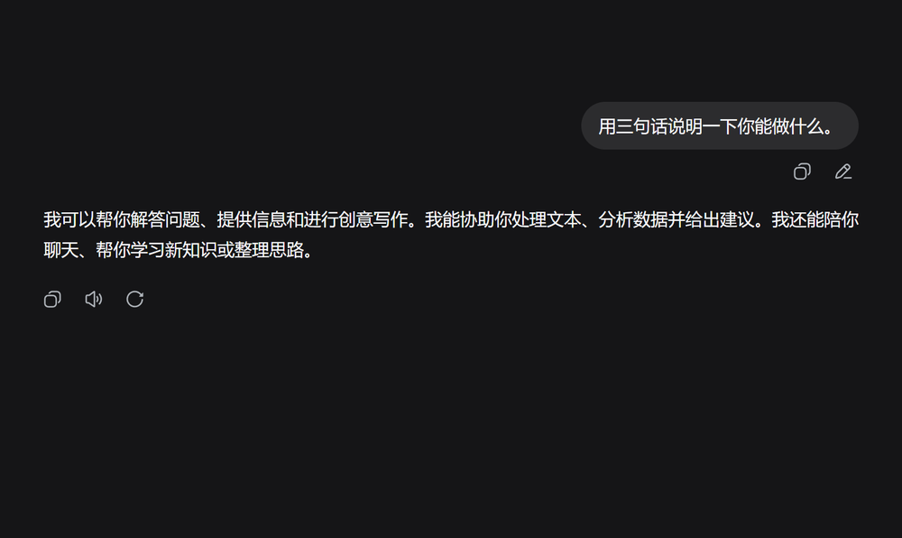

# DGX Chat

**A self-hosted, multi-user chat UI for your own OpenAI-compatible model
gateway — with accounts, cloud-synced sessions, web search, speech, and an
Android app.**

DGX Chat is a *client + backend* pair you run yourself: a FastAPI service that
speaks the DeepSeek/Anthropic Messages protocol the bundled React front end
expects, backed by SQLite, packaged as a single Docker image. Point it at
whatever inference endpoint you like — vLLM, llama.cpp, Ollama, LiteLLM, or a
hosted OpenAI-compatible API — and every device in your household gets the same
chat history behind a login.

It is a fork of the front end from
[deepseek-ai/chat-demo](https://github.com/deepseek-ai/chat-demo) (MIT),
extended with runtime-configurable server address, accounts, cloud session sync
and a Capacitor Android shell.



The web UI is a single centred chat column on a dark, near-black background: a
collapsible left sidebar listing conversations grouped by date, a composer at
the bottom with attach / microphone / send controls, and message bubbles that
render Markdown, syntax-highlighted code, KaTeX math and Mermaid diagrams
inline. A settings dialog (gear icon) exposes the server address, account,
voice and model options.

---

## Features

- **Runs on your own hardware.** One Docker image + a SQLite file. No SaaS, no
  telemetry, no account on anyone else's server.
- **Multi-user with real isolation.** Registration with invite codes (the first
  account becomes the administrator), per-user sessions, per-user attachments,
  token auth, login/registration rate limiting.
- **Cloud-synced conversations.** Sessions live in SQLite and are pulled to any
  device you log in on; IndexedDB is only a cache.
- **Works with any OpenAI-compatible endpoint.** Set one URL and one model map;
  up to four fallback endpoints are supported.
- **Streaming with thinking.** Reasoning deltas are rendered as a collapsible
  "thinking" section when your gateway emits them.
- **Markdown, code, math, diagrams.** Syntax highlighting, KaTeX, Mermaid.
- **Web search + link reading.** Either full DeepSeek relay mode, or local
  retrieval that feeds your own model with citations.
- **Voice.** Text-to-speech playback and microphone transcription, via DeepSeek
  or any OpenAI-compatible TTS/ASR endpoint.
- **Android APK.** Capacitor shell, server address configurable at runtime — one
  APK works against any deployment.
- **Admin page.** User management, invite codes, usage stats.

## Architecture

```
┌──────────────────────────┐        ┌──────────────────────────┐
│  Browser (React app)     │        │  Android APK (Capacitor) │
└────────────┬─────────────┘        └────────────┬─────────────┘
             │  Anthropic Messages + /api/*      │
             │  (Bearer token)                   │
             ▼                                   ▼
      ┌──────────────────────────────────────────────┐
      │  server/  FastAPI + SQLite + Docker image     │
      │  auth · sessions · files · admin · rate limit │
      └───────┬───────────────────────────┬──────────┘
              │ answer text               │ search / ASR / TTS
              ▼                           ▼
   ┌──────────────────────┐   ┌───────────────────────────┐
   │ OpenAI-compatible    │   │ DeepSeek official API      │
   │ gateway (yours)      │   │ (optional: retrieval only) │
   └──────────────────────┘   └───────────────────────────┘
```

The answer text always comes from **your** gateway. The optional DeepSeek key is
used only for web retrieval, speech synthesis and speech recognition — never for
the chat completion itself.

Repository layout:

| Path | Contents |
|---|---|
| `server/` | FastAPI backend + Dockerfile + compose file |
| `app/` | React front end (fork of chat-demo), `pnpm build` → `app/dist` |
| `android/` | Capacitor shell and APK build tooling |
| `scripts/` | `quickstart.sh` / `quickstart.ps1` |
| `deploy/` | optional SSH deploy helper + example config |
| `tools/` | operator utilities (SSH helper, end-to-end acceptance client) |
| `docs/` | self-hosting notes |

## Requirements

- Docker Engine 20.10+ with the Compose plugin (or Docker Desktop).
- ~500 MB disk (image + data), 1 CPU core, 512 MB RAM.
- An OpenAI-compatible inference endpoint you can reach.
- For the Android APK only: JDK 17, Android SDK 35, Node 20+, pnpm.

## Deploy in one command

```sh
git clone https://github.com/<you>/dgxchat.git
cd dgxchat
./scripts/quickstart.sh
```

Windows:

```powershell
git clone https://github.com/<you>/dgxchat.git
cd dgxchat
pwsh ./scripts/quickstart.ps1
```

The script:

1. checks that `docker` and `docker compose` are available;
2. creates `.env` from the template if it does not exist, generating random
   values for everything that should be random;
3. builds and starts the stack;
4. waits for `/health` and prints the URL, the first-admin instructions and the
   log command.

It is safe to re-run: existing `.env` and data are never overwritten.

Then open **http://localhost:8439/**, click *register* — **the first account
becomes the administrator** — and go to `/admin` to create invite codes or more
users.

Manual equivalent, once `.env` exists:

```sh
cd server
docker compose up -d --build
docker compose logs -f
```

### Container image

A self-contained image (backend **and** web client) is published to GitHub
Packages on every release:

```sh
docker run -d --name dgx-chat -p 8439:8439 \
  -v dgxchat-data:/data \
  -e DGX_BASE_URL=http://your-gateway:8000/v1 \
  ghcr.io/nestufng/dgx-chat:latest
```

Tags are `latest` and the release version (for example `1.0.2`). The image runs
as uid 10001, keeps SQLite and uploads in the `/data` volume, and needs no bind
mounts for the UI. Set the remaining options with `-e` — see
[`server/.env.example`](server/.env.example) for the full list.

> On a private repository the package inherits that visibility. Make the package
> public from its package page if you want anyone to pull it anonymously.

### Point it at your endpoint

Edit `.env`:

```ini
DGX_BASE_URL=http://your-gateway:8041/v1     # OpenAI-compatible /chat/completions
DGX_API_KEY=                                 # empty for an unauthenticated gateway
DGX_MODEL_MAP={"deepseek-flash":"your-model","deepseek-v4-pro":"your-model"}
```

The two ids on the left are the only model names the client knows; map both to
whatever your gateway actually serves. Restart with `docker compose up -d`, then
check:

```sh
curl -s http://localhost:8439/health
```

The full set of upstream-tuning variables (`DGX_TIMEOUT`, `DGX_MAX_TOKENS`,
`DGX_THINKING_DISABLE_MODE`, `DGX_BASE_URL_FALLBACK`, …) is documented in
[`server/.env.example`](server/.env.example).

## Configuration

All settings are environment variables in `.env`. The ones that matter most:

| Variable | Default | Description |
|---|---|---|
| `DGX_BASE_URL` | `http://localhost:8041/v1` | Primary OpenAI-compatible endpoint. **Set this.** |
| `DGX_API_KEY` | *(empty)* | Bearer token for that endpoint, if it needs one |
| `DGX_MODEL_MAP` | — | JSON map of client model id → upstream model id |
| `DGX_BASE_URL_FALLBACK` | *(empty)* | Optional fallback endpoint (up to 4: `_2`, `_3`) |
| `DGX_THINKING_DISABLE_MODE` | `reasoning_effort` | How to turn reasoning off for your upstream |
| `DEEPSEEK_API_KEY` | *(empty)* | Optional. Enables web search, TTS and ASR |
| `SEARCH_MODE` | `dgx` | `dgx` (local answers + retrieval) / `official` (full relay) / `off` |
| `REGISTRATION_MODE` | `invite` | `invite` / `closed` / `open` — first user is always allowed |
| `DGXCHAT_PORT` | `8439` | Published port |
| `DGXCHAT_DATA_DIR` | `/data` | SQLite + attachments (inside the container) |
| `TOKEN_TTL_DAYS` | `0` | Session token lifetime; `0` = never expires |
| `LOGIN_MAX_FAILURES` | `10` | Failed logins per window |
| `REGISTER_MAX_PER_HOUR` | `5` | Registrations per IP per hour |
| `DAILY_TTS_CHARS` | `20000` | Per-user daily TTS quota (`0` = unlimited) |
| `DGXCHAT_TRUST_PROXY` | `0` | Set to `1` only behind a reverse proxy |
| `DGXCHAT_DOCS` | `0` | Set to `1` to expose `/docs` and `/openapi.json` |

Complete reference: [`server/.env.example`](server/.env.example).

## Security notes

- **Secrets live in git-ignored files only.** `.env`, `deploy/.env.deploy`,
  `tools/nas.env` and the Android keystore are all ignored; only `.example`
  templates are committed. If you fork this, never commit your own `.env`.
- **Change the defaults before exposing it.** The stack binds `0.0.0.0:8439`
  with plain HTTP. Put it behind a TLS reverse proxy or a VPN before it leaves
  your network.
- **Registration is invite-only by default**, but the first account to register
  on an empty database becomes administrator — create it yourself immediately.
- **Rate limits are process-local** in-memory counters. They reset on restart
  and are not shared between replicas, so they are a speed bump, not a defence
  against a determined attacker. Put a real rate limiter in front if the service
  is public.
- **Tokens never expire by default.** Revoke them from the admin page, or set
  `TOKEN_TTL_DAYS`.
- `CORS_ALLOW_ORIGINS=*` is allowed for convenience on a private network; narrow
  it for anything public.
- Uploaded files and chat history are stored unencrypted in the data volume.
  Encrypt the disk if that matters to you.
- The Android build allows cleartext HTTP (the app has to talk to a LAN server);
  switch `cleartextTrafficPermitted` off once you have HTTPS.

Found a security issue? See [SECURITY.md](SECURITY.md).

## Install the Android app

A prebuilt, signed APK is committed at
[`release/DGX-Chat-1.0.1.apk`](release/DGX-Chat-1.0.1.apk)
(sha256 in [`release/DGX-Chat-1.0.1.apk.sha256`](release/DGX-Chat-1.0.1.apk.sha256)).

Copy it to the phone, allow installing from unknown sources, open it and enter
**your** server address (`http://<host>:8439`) on the login screen, then sign in.
The APK ships with **no** server address — the field is empty and required, so it
cannot silently point at somebody else's machine. The address is kept on the
device and can be changed any time under Settings → Server / Account, so one APK
works against every deployment.

(In the browser build this is automatic: opened from the server itself, the app
uses the address of the page you are already on.)

If your phones cannot reach an SMB share, serve the APK from the backend
instead: drop it in the `web/release/` directory next to the container and it is
downloadable at `http://<host>:8439/release/<file>.apk`, which any mobile
browser can open. `python tools/publish_apk.py` does this for you (it also
copies the APK to a share folder), and `deploy/deploy.py` re-publishes it after
every sync.

Requirements: Android 7.0 (API 24) or newer. The app is signed with a project
key; installing over a build signed by a different key requires uninstalling
first.

## Build the Android APK yourself

Prerequisites: JDK 17, Android SDK 35, Node 20+, pnpm.

```sh
cd app
pnpm install
pnpm build                   # produces app/dist
                             # optional: DGX_API_ORIGIN=http://your-host:8439 pnpm build
                             #           to pre-fill the server address

cd ../android
pnpm install
npx cap sync android
cd android && ./gradlew assembleRelease        # gradlew.bat on Windows
```

The APK lands in `android/android/app/build/outputs/apk/release/app-release.apk`.
To sign it with your own key, export `DGX_KEYSTORE_FILE`,
`DGX_KEYSTORE_PASSWORD`, `DGX_KEY_ALIAS`, `DGX_KEY_PASSWORD` (or create
`android/keystore/keystore.properties`) — without them the release APK is built
**unsigned** rather than signed with a shared key.

The server address is a runtime setting, so one APK works against any
deployment. Full details: [android/BUILD.md](android/BUILD.md). Tagged releases
can build and attach the APK automatically — see
[`.github/workflows/release-apk.yml`](.github/workflows/release-apk.yml).

## Development

```sh
# backend
cd server && python -m venv .venv && . .venv/bin/activate
pip install -r requirements.txt
uvicorn app.main:app --reload --port 8439

# front end (dev server on :8090, proxying to the backend)
cd app && pnpm install && pnpm dev
```

Tests: `pytest` in `server/`; front-end checks are `pnpm type` and `pnpm build`
in `app/`. CI runs both ([`.github/workflows/ci.yml`](.github/workflows/ci.yml)).

## Limitations

This is a homelab-grade project, and it is honest about it:

- **No PDF/Word layout recognition.** Text-decodable documents (plain text,
  Markdown, CSV, source code) are sent to the model; scanned PDFs and complex
  document layouts are not parsed.
- **Rate limits are single-process and in-memory** (see Security notes).
- **No remote-delete broadcast.** Deleting a conversation on one device does not
  remove it from your other devices until they delete it locally. Sync is
  last-write-wins by client timestamp.
- **No encryption at rest**, no backup automation, no migration tooling beyond
  SQLite itself.
- Reasoning output is only available if your gateway streams it.
- The Android app is not on any store; sideload it.

## License and attribution

MIT — see [LICENSE](LICENSE). The front end in `app/` is derived from
[deepseek-ai/chat-demo](https://github.com/deepseek-ai/chat-demo) (MIT,
Copyright (c) 2026 DeepSeek); the upstream license text and attribution are kept
in [app/LICENSE](app/LICENSE), [app/NOTICE](app/NOTICE) and [NOTICE](NOTICE).

---

## 中文简介

**DGX Chat** 是一个自托管的多人聊天前端 + 后端：前端来自
[deepseek-ai/chat-demo](https://github.com/deepseek-ai/chat-demo)（MIT）并做了改造，
后端是 FastAPI + SQLite，打包成一个 Docker 镜像。把它指向你自己的
OpenAI 兼容推理网关（vLLM / llama.cpp / Ollama / LiteLLM 或任意云服务），
家里所有设备登录同一个账号就能看到同一份会话历史。

**一键部署**（需要 docker 与 docker compose）：

```sh
./scripts/quickstart.sh                     # Linux / macOS / NAS
pwsh ./scripts/quickstart.ps1               # Windows
```

脚本会在缺少 `.env` 时自动生成（随机项自动随机），启动服务并等待 `/health`，
然后打印访问地址和日志命令；重复执行不会覆盖已有配置和数据。

启动后打开 `http://localhost:8439/`，**第一个注册的账号自动成为管理员**，
之后在 `/admin` 里发邀请码或创建用户。

**怎么接自己的模型**：改 `.env` 里的 `DGX_BASE_URL`（OpenAI 兼容的
`/chat/completions` 地址）、`DGX_API_KEY`（网关不鉴权就留空）、
`DGX_MODEL_MAP`（把客户端的两个模型 id 映射到你的模型名）；`DEEPSEEK_API_KEY`
是可选的，只用于联网检索、TTS 和 ASR，不参与正文生成。

**已知限制**：不支持 PDF/Word 版面识别（只处理可解码为文本的内容）；限流是
单进程内存计数；在一台设备删除的会话不会广播到其他设备（同步为后写覆盖）；
数据卷不加密。

**许可证**：MIT（见 [LICENSE](LICENSE)）；前端源自 chat-demo，其 LICENSE 与
NOTICE 一并保留。
