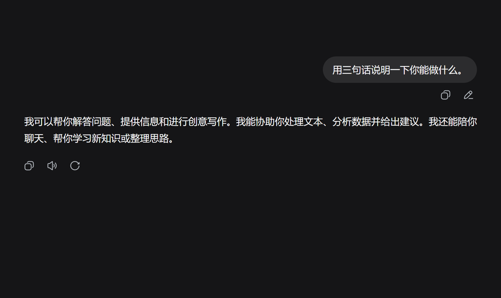

# DGX Chat

[English](README.md) | **简体中文**

**一个自托管、多用户的聊天界面，给「你自己的 OpenAI 兼容模型网关」用 —— 带账号、
云端会话同步、联网搜索、语音，以及安卓 App。**

DGX Chat 是一套**前端 + 后端**，由你自己运行：一个 FastAPI 服务，讲的是内置 React
前端所期望的 DeepSeek / Anthropic Messages 协议，数据存在 SQLite，打包成一个
Docker 镜像。把它指向任何你想用的推理端点 —— vLLM、llama.cpp、Ollama、LiteLLM，
或者某个托管的 OpenAI 兼容 API —— 家里每台设备登录后看到的都是同一份聊天记录。

前端源自 [deepseek-ai/chat-demo](https://github.com/deepseek-ai/chat-demo)（MIT），
在此基础上增加了运行期可配置的服务器地址、账号体系、云端会话同步，以及
Capacitor 安卓外壳。



界面是一个居中的深色聊天栏：左侧可折叠边栏按日期分组列出会话；底部输入区带附件、
麦克风和发送；消息气泡内联渲染 Markdown、代码高亮、KaTeX 公式和 Mermaid 图表。
设置弹窗（齿轮图标）里可以改服务器地址、账号、朗读音色和模型。

---

## 功能

- **跑在你自己的硬件上。** 一个 Docker 镜像 + 一个 SQLite 文件。没有 SaaS、没有
  遥测、不需要在别人的服务器上开账号。
- **真多用户、真隔离。** 邀请码注册（第一个账号自动成为管理员），会话按用户隔离，
  附件按用户隔离，Token 鉴权，登录/注册限流。
- **会话存云端。** 会话在 SQLite 里，登录任何设备都能拉到；IndexedDB 只是缓存。
- **兼容任何 OpenAI 兼容端点。** 填一个 URL 和一张模型映射表；支持最多 4 个兜底端点。
- **流式输出，带思维链。** 上游下发 reasoning 时，界面会渲染成可折叠的「思考」区块。
- **Markdown / 代码 / 公式 / 图表。** 语法高亮、KaTeX、Mermaid。
- **联网搜索 + 链接阅读。** 可以整轮转官方，也可以本地检索后喂给自己的模型并附引用。
- **语音。** 朗读和录音转写，走 DeepSeek 官方，或任何 OpenAI 兼容的 TTS/ASR 端点。
- **安卓 APK。** Capacitor 外壳，服务器地址运行期可改 —— 一个包适配任何部署。
- **管理后台。** 用户管理、邀请码、用量统计。

## 架构

```
┌──────────────────────────┐        ┌──────────────────────────┐
│  浏览器（React 前端）     │        │  安卓 APK（Capacitor）    │
└────────────┬─────────────┘        └────────────┬─────────────┘
             │  Anthropic Messages + /api/*      │
             │  （Bearer token）                 │
             ▼                                   ▼
      ┌──────────────────────────────────────────────┐
      │  server/  FastAPI + SQLite + Docker 镜像      │
      │  鉴权 · 会话 · 文件 · 管理 · 限流              │
      └───────┬───────────────────────────┬──────────┘
              │ 正文                     │ 检索 / ASR / TTS
              ▼                           ▼
   ┌──────────────────────┐   ┌───────────────────────────┐
   │ OpenAI 兼容网关        │   │ DeepSeek 官方 API          │
   │ （你自己的）           │   │ （可选，只用于检索）        │
   └──────────────────────┘   └───────────────────────────┘
```

**正文永远来自你自己的网关。** 可选的 DeepSeek key 只用于联网检索、语音合成和语音
识别 —— 从不参与聊天正文的生成。

仓库结构：

| 路径 | 内容 |
|---|---|
| `server/` | FastAPI 后端 + Dockerfile + compose 文件 |
| `app/` | React 前端（chat-demo 的改造版），`pnpm build` → `app/dist` |
| `android/` | Capacitor 工程与 APK 打包脚本 |
| `scripts/` | `quickstart.sh` / `quickstart.ps1` |
| `deploy/` | 可选的 SSH 部署辅助脚本与配置示例 |
| `tools/` | 运维工具（SSH 辅助、端到端验收客户端） |
| `docs/` | 自托管说明 |

## 环境要求

- Docker Engine 20.10+ 并带 Compose 插件（或 Docker Desktop）。
- 约 500 MB 磁盘（镜像 + 数据）、1 核 CPU、512 MB 内存。
- 一个你能访问到的 OpenAI 兼容推理端点。
- 仅打安卓 APK 时需要：JDK 17、Android SDK 35、Node 20+、pnpm。

## 一条命令部署

```sh
git clone https://github.com/NestuFNG/dgx-chat.git
cd dgx-chat
./scripts/quickstart.sh
```

Windows：

```powershell
git clone https://github.com/NestuFNG/dgx-chat.git
cd dgx-chat
pwsh ./scripts/quickstart.ps1
```

脚本会：

1. 检查 `docker` 与 `docker compose` 是否可用；
2. 若 `.env` 不存在则从模板生成，该随机的项自动随机；
3. 构建并启动服务；
4. 等待 `/health`，然后打印访问地址、首个管理员的创建方式、以及查看日志的命令。

**可以安全地重复执行**：已有的 `.env` 和数据不会被覆盖。

然后打开 **http://localhost:8439/**，点「注册」—— **第一个注册的账号自动成为管理员**
—— 再进 `/admin` 创建邀请码或更多用户。

`.env` 已存在之后，手动等价命令：

```sh
cd server
docker compose up -d --build
docker compose logs -f
```

### 容器镜像

每次发布都会把一个**自包含**镜像（后端 **和** 网页版）推到 GitHub Packages：

```sh
docker run -d --name dgx-chat -p 8439:8439 \
  -v dgxchat-data:/data \
  -e DGX_BASE_URL=http://your-gateway:8000/v1 \
  ghcr.io/nestufng/dgx-chat:latest
```

Tag 有 `latest` 和版本号（例如 `1.0.2`）。镜像以 uid 10001 运行，SQLite 和上传附件
都在 `/data` 卷里，网页版已内置、不需要额外挂载。其余配置用 `-e` 传 ——
完整清单见 [`server/.env.example`](server/.env.example)。

> 私有仓库的镜像会继承私有可见性。想让别人匿名 `docker pull`，需要到包页面把
> visibility 改成 public。

### 指向你自己的端点

编辑 `.env`：

```ini
DGX_BASE_URL=http://your-gateway:8041/v1     # OpenAI 兼容的 /chat/completions
DGX_API_KEY=                                 # 网关不鉴权就留空
DGX_MODEL_MAP={"deepseek-flash":"your-model","deepseek-v4-pro":"your-model"}
```

左边两个 id 是客户端唯一认识的模型名；把两个都映射到你网关实际提供的模型。
改完 `docker compose up -d` 重启，然后检查：

```sh
curl -s http://localhost:8439/health
```

完整的上游调参变量（`DGX_TIMEOUT`、`DGX_MAX_TOKENS`、`DGX_THINKING_DISABLE_MODE`、
`DGX_BASE_URL_FALLBACK` 等）见 [`server/.env.example`](server/.env.example)。

## 配置

所有配置都是 `.env` 里的环境变量，最常用的这些：

| 变量 | 默认值 | 说明 |
|---|---|---|
| `DGX_BASE_URL` | `http://localhost:8041/v1` | 主 OpenAI 兼容端点。**必须改。** |
| `DGX_API_KEY` | *(空)* | 该端点的 Bearer Token（需要鉴权时填） |
| `DGX_MODEL_MAP` | — | JSON：客户端模型 id → 上游模型 id |
| `DGX_BASE_URL_FALLBACK` | *(空)* | 可选兜底端点（最多 4 个：`_2`、`_3`） |
| `DGX_THINKING_DISABLE_MODE` | `reasoning_effort` | 如何关闭上游的思维链 |
| `DEEPSEEK_API_KEY` | *(空)* | 可选。开启联网搜索、TTS、ASR |
| `SEARCH_MODE` | `dgx` | `dgx`（本地出答案 + 检索）/ `official`（整轮转官方）/ `off` |
| `REGISTRATION_MODE` | `invite` | `invite` / `closed` / `open` —— 第一个用户始终允许 |
| `DGXCHAT_PORT` | `8439` | 对外端口 |
| `DGXCHAT_DATA_DIR` | `/data` | SQLite + 附件目录（容器内） |
| `TOKEN_TTL_DAYS` | `0` | 会话 Token 有效期；`0` = 永不过期 |
| `LOGIN_MAX_FAILURES` | `10` | 一个窗口内允许的登录失败次数 |
| `REGISTER_MAX_PER_HOUR` | `5` | 每 IP 每小时注册次数 |
| `DAILY_TTS_CHARS` | `20000` | 每用户每日 TTS 字符配额（`0` = 不限） |
| `DGXCHAT_TRUST_PROXY` | `0` | **只有**在反向代理后面才设为 `1` |
| `DGXCHAT_DOCS` | `0` | 设为 `1` 才暴露 `/docs` 和 `/openapi.json` |

完整参考：[`server/.env.example`](server/.env.example)。

## 安全须知

- **机密只放在被 git 忽略的文件里。** `.env`、`deploy/.env.deploy`、`tools/nas.env`
  和安卓 keystore 全部被忽略，仓库里只有 `.example` 模板。如果你 fork 了本项目，
  **千万别把自己的 `.env` 提交上去**。
- **暴露到公网前先改默认值。** 服务以明文 HTTP 监听 `0.0.0.0:8439`。在把它放出
  你的局域网之前，请放到 TLS 反向代理或 VPN 后面。
- **注册默认是邀请制**，但**空库时第一个注册的账号自动成为管理员** —— 部署完请
  立刻自己注册占位。
- **限流是进程内内存计数。** 重启即清零，多副本之间也不共享，所以它只是减速带，
  挡不住有决心的攻击者。服务要公开的话，前面再放一个真正的限流器。
- **Token 默认永不过期。** 可以在管理后台吊销，或设置 `TOKEN_TTL_DAYS`。
- 私有网络里图方便可以 `CORS_ALLOW_ORIGINS=*`；要公开就收紧。
- 上传的文件和聊天记录以**未加密**方式存放在数据卷里；在意的话请加密磁盘。
- 安卓包允许明文 HTTP（App 需要连局域网服务器）；有了 HTTPS 之后请把
  `cleartextTrafficPermitted` 关掉。

发现安全问题？见 [SECURITY.md](SECURITY.md)。

## 安装安卓 App

已签名的 APK 挂在[最新 Release](https://github.com/NestuFNG/dgx-chat/releases/latest)，
仓库里也有一份：[`release/DGX-Chat-1.0.2.apk`](release/DGX-Chat-1.0.2.apk)
（校验值在同目录 `.sha256` 文件里）。

把它传到手机、允许「安装未知来源应用」、打开，在登录页填**你自己的**服务器地址
（`http://<主机>:8439`），然后登录。**APK 里不含任何服务器地址** —— 那个输入框是空的
且必填，所以它不会悄悄连到别人的机器上。地址存在本机，之后随时可以在
「设置 → 服务器 / 账号」里改，因此一个包适配所有部署。

（浏览器版是自动的：从服务器本身打开时，App 直接用当前页面的地址。）

如果手机访问不到 SMB 共享，也可以让后端来提供：把 APK 丢进容器旁边的
`web/release/` 目录，就能在 `http://<主机>:8439/release/<文件名>.apk` 下载 ——
任何手机浏览器都能打开。`python tools/publish_apk.py` 会自动做这件事（它同时也会
拷一份到共享目录），`deploy/deploy.py` 每次同步后也会重新发布。

要求：Android 7.0（API 24）或更高。APK 用项目密钥签名；如果手机上装的是用**另一把**
密钥签名的旧版本，必须先卸载。

## 自己打安卓 APK

前置：JDK 17、Android SDK 35、Node 20+、pnpm。

```sh
cd app
pnpm install
pnpm build                   # 产出 app/dist
                             # 可选：DGX_API_ORIGIN=http://your-host:8439 pnpm build
                             #       把服务器地址预置进包里

cd ../android
pnpm install
npx cap sync android
cd android && ./gradlew assembleRelease        # Windows 用 gradlew.bat
```

产物在 `android/android/app/build/outputs/apk/release/app-release.apk`。
想用自己的密钥签名，导出 `DGX_KEYSTORE_FILE`、`DGX_KEYSTORE_PASSWORD`、
`DGX_KEY_ALIAS`、`DGX_KEY_PASSWORD`（或创建 `android/keystore/keystore.properties`）
—— 不提供时 release 包会是**未签名**的，而不是用某个共享密钥签。

服务器地址是运行期设置，所以一个包适配任何部署。完整说明见
[android/BUILD.md](android/BUILD.md)。打 tag 时也可以自动构建并附到 Release ——
见 [`.github/workflows/release-apk.yml`](.github/workflows/release-apk.yml)。

## 开发

```sh
# 后端
cd server && python -m venv .venv && . .venv/bin/activate
pip install -r requirements.txt
uvicorn app.main:app --reload --port 8439

# 前端（开发服务器 :8090，代理到后端）
cd app && pnpm install && pnpm dev
```

测试：在 `server/` 里跑 `pytest`；前端检查是 `app/` 里的 `pnpm type` 和 `pnpm build`。
CI 两者都跑（[`.github/workflows/ci.yml`](.github/workflows/ci.yml)）。

## 已知限制

这是个自托管向的项目，也坦白自己的短板：

- **没有 PDF/Word 版面识别。** 能解码成文本的文档（纯文本、Markdown、CSV、源码）
  会发给模型；扫描版 PDF 和复杂版面不做解析。
- **限流是单进程内存计数**（见上面「安全须知」）。
- **删除不跨设备广播。** 在一台设备删除会话，其他设备不会自动消失，直到本地也删。
  同步采用「客户端时间戳后写覆盖」。
- **没有静态加密**，没有自动备份，也没有 SQLite 以外的迁移工具。
- 思维链只在你的网关会下发时才有。
- 安卓 App 不在任何应用商店，需要侧载。

## 许可证与署名

MIT —— 见 [LICENSE](LICENSE)。`app/` 里的前端源自
[deepseek-ai/chat-demo](https://github.com/deepseek-ai/chat-demo)（MIT，
Copyright (c) 2026 DeepSeek）；上游的许可证原文与署名保留在
[app/LICENSE](app/LICENSE)、[app/NOTICE](app/NOTICE) 和 [NOTICE](NOTICE)。
